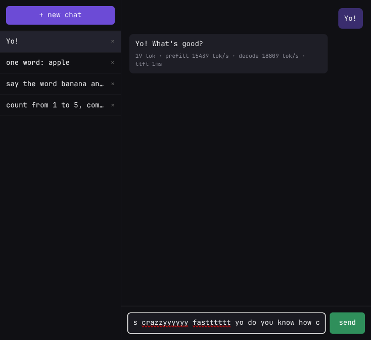

# chatjimmy-api

A tiny, dependency-free Node web API + UI that turns [chatjimmy.ai](https://chatjimmy.ai/) (Taalas' free `llama3.1-8B` demo, ~17,000 tok/s) into a real chat service:

> **input makes a new chat in the bar — output fetches the result — the first prompt retries.**



## Why

chatjimmy.ai's own front-end is **stateless**: it reverse-engineers to `POST /api/chat` (Vercel AI SDK, plain-text stream, trailing `<|stats|>json<|/stats|>` sentinel), but conversations live only in browser `localStorage`, and there is no recovery when the first prompt flakes. The existing ecosystem (see [prior art](#prior-art)) mostly re-exposes it as an OpenAI-compatible proxy — fine for one-shot completions, but chat management still falls on the caller.

`chatjimmy-api` instead owns the chat lifecycle server-side:

- **Chat bar API** — creating a chat from your first input, listing/fetching/deleting chats, JSON persistence
- **Retry the first prompt** — 2 automatic retries with backoff; if all attempts fail the chat survives with a `chatId` and a manual `/retry` endpoint re-runs the exact prompt
- **Per-reply token stats** — upstream's hidden `<|stats|>` block (prefill/decode tok/s, TTFT, token counts) parsed out and returned
- **Passthrough of upstream `chatOptions`** — system prompt, top-K, etc.
- Zero npm dependencies (Node ≥ 18 global `fetch`), open CORS, plus a one-file vanilla-JS UI

## Quickstart

```bash
node server.js
# chatjimmy-api on http://localhost:8787 (upstream https://chatjimmy.ai, retries 2)
```

```bash
curl -X POST localhost:8787/api/chat \
  -H 'content-type: application/json' \
  -d '{"content":"count 1 to 5"}'
```

```json
{
  "chat":   { "id": "chat_…", "title": "count 1 to 5", "messageCount": 2, … },
  "reply":  "1, 2, 3, 4, 5",
  "stats":  { "total_tokens": 34, "prefill_rate": 17663, "decode_rate": 17265, "ttft": 0.0011, … },
  "attempts": 1
}
```

## API

| Method & path | Body | Purpose |
|---|---|---|
| `POST /api/chat` | `{content, chatOptions?}` | **One-shot: new chat + first prompt.** The chat appears in the bar (`GET /api/chats`), prompt auto-retries (default 3 attempts total). Total failure → `502 {error, attempts, chatId, hint}`, chat kept for manual retry. |
| `POST /api/chats` | `{}` | Create an empty chat. |
| `GET /api/chats` | | List chats for the bar: `{id, title, messageCount, updatedAt, lastError…}` (title = first input). |
| `GET /api/chats/:id` | | Full chat: every message with parsed token `stats` and `attempts`. |
| `POST /api/chats/:id/messages` | `{content, chatOptions?}` | Continue the chat — full history is replayed upstream. |
| `POST /api/chats/:id/retry` | | Re-run the **last user prompt** (truncates the failed/answered turn first). |
| `DELETE /api/chats/:id` | | Delete a chat. |
| `GET /api/models` | | Proxied upstream model list. |
| `GET /` | | Web UI (sidebar bar + input; spawn chats by typing; retry button on failure). |

`chatOptions` is forwarded verbatim to upstream (observed fields: `selectedModel`, `systemPrompt`, `topK`, sliders in the settings tab). Default `selectedModel`: `llama3.1-8B`.

### Error / retry semantics

```text
attempt 1 ── fail ──▶ sleep 0.5s ──▶ attempt 2 ── fail ──▶ sleep 1s ──▶ attempt 3
   │                                                                    │
   └── success ⇒ {reply, stats, attempts}                               └── all fail ⇒ 502
                                                                          chat kept, POST /:id/retry
```

Empty upstream bodies (`""`), non-2xx, and timeouts all count as failures worth retrying.

## Configuration (env)

| Var | Default | |
|---|---|---|
| `PORT` | `8787` | listen port |
| `CHATJIMMY_URL` | `https://chatjimmy.ai` | upstream (point at a mock for tests) |
| `CHATJIMMY_MODEL` | `llama3.1-8B` | default `selectedModel` |
| `CHATJIMMY_RETRIES` | `2` | retries beyond the first attempt |
| `CHATJIMMY_TIMEOUT_MS` | `120000` | per-attempt fetch timeout |

State is persisted to `data/chats.json` (gitignored).

## How it talks to chatjimmy.ai

Everything the web app does, reconstructed from its Next.js bundle:

- `POST {UPSTREAM}/api/chat`, JSON `{chatOptions: {selectedModel, …}, messages: [{role, content}]}`
- Response: `streamMode: "text"` — the raw completion as plain text
- A trailing sentinel carries metrics:

  ```text
  <reply text><|stats|>{"prefill_rate":…,"decode_rate":…,"ttft":…}<|/stats|>
  ```

  `extractStats()` splits content from metrics; the sentinel never reaches clients.
- `GET {UPSTREAM}/api/models` → `{object:"list",data:[{id:"llama3.1-8B",owned_by:"Taalas Inc."}]}`

## Prior art

OpenAI-compatible proxies and wrappers in the wild, for comparison: [cj2api](https://github.com/qingchencloud/cj2api), [jimmy-proxy](https://github.com/Fadeleke57/jimmy-proxy), [chatjimmy-api (Python)](https://github.com/0xMH/chatjimmy-api), [taalas-chatjimmy-wrapper](https://github.com/Zoheb-Malik/taalas-chatjimmy-wrapper), [chatjimmy-to-api-workers](https://github.com/6Kmfi6HP/chatjimmy-to-api-workers), [blitz](https://github.com/mishl-dev/blitz). None of them persist chats or handle first-prompt recovery; this repo isn't a proxy — it's the missing session layer, and composable with those.

## Notes & disclaimer

Unofficial; not affiliated with Taalas. Scraping their demo endpoint is exactly what a browser tab does, but assume no SLA and respect reasonable use. If the wire format changes, the header comment in `server.js` explains how to re-derive it from their bundle. MIT licensed.
